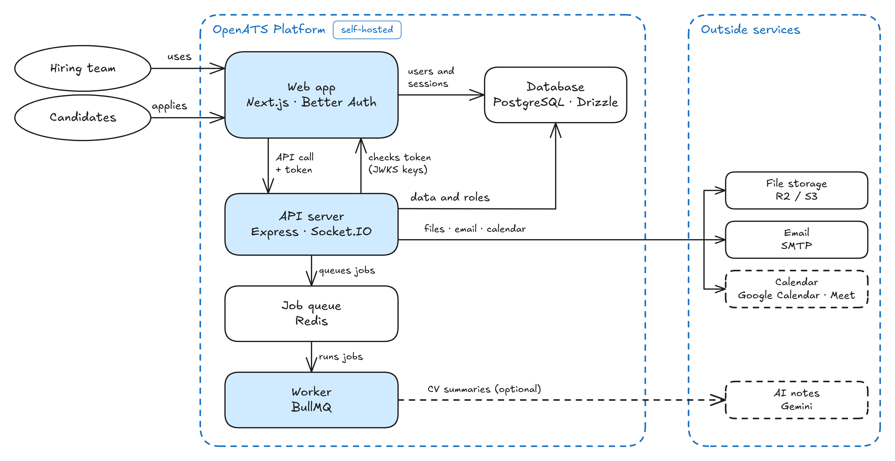

<h1 align="center">
  <picture>
    <source media="(prefers-color-scheme: dark)" srcset="./frontend/public/assets/openats-readme-white.png">
    
  </picture>
</h1>

<p align="center">
  <strong>An open-source hiring platform to streamline recruitment and hire faster.</strong>
</p>

<p align="center">
  <a href="https://demo.openats.dev"><strong>Live demo</strong></a> ·
  <a href="https://openats.dev"><strong>Documentation</strong></a> ·
  <a href="#getting-started"><strong>Getting started</strong></a> ·
  <a href="#architecture"><strong>Architecture</strong></a> ·
  <a href="./CONTRIBUTING.md"><strong>Contributing</strong></a>
</p>

<p align="center">
  <a href="./LICENSE"></a>
  <a href="https://github.com/chamals3n4/OpenATS/actions/workflows/ci.yml"></a>
  <a href="https://github.com/chamals3n4/OpenATS/releases"></a>
  
</p>

---

OpenATS is an open-source applicant tracking system. It gives your team one shared workspace for hiring and replaces the spreadsheets, inboxes and separate tools that hiring usually runs on. A candidate moves through one clear process, from the open role through interviews to the final decision.

You host it yourself, so your candidates' data stays on infrastructure you control.

## Features

| Feature | What it does |
| --- | --- |
| **Jobs and careers page** | Create jobs with departments, salaries and your own application questions. Publish them on the built-in careers page, or embed them on your own website. |
| **Candidate pipeline** | Move candidates through your own hiring stages on a drag-and-drop board, with filters, bulk actions and a full stage history. |
| **CV search** | OpenATS reads the text of every uploaded CV on your own server. You can search across all CVs and see where the words matched. |
| **Scoring** | Each job decides how much application answers, assessments, ratings and interviews count. Every candidate gets a total score. |
| **Assessments** | Build tests with multiple-choice and written questions, send them automatically at a stage, and grade written answers. |
| **Assignments** | Send take-home tasks with a brief, resource links and a hand-in form. Candidates hand in their work once, before the deadline. |
| **Interviews** | Schedule interviews and let candidates pick from the slots you offer. Interviews go into the interviewer's Google Calendar with a Meet link, and interviewers fill in scorecards. |
| **Offers** | Write offer letters from templates and send them. Candidates accept or decline online before the offer expires. |
| **Emails** | Email candidates from templates, and reword the emails that OpenATS sends automatically. |
| **Notifications** | The bell in the dashboard tells the hiring team when a candidate applies, books an interview, hands in work or answers an offer. |
| **Team collaboration** | Each job's hiring team gets a private discussion, star ratings and shared notes. |
| **Roles and access** | Super admins, hiring managers and interviewers. Interviewers only see the jobs they are assigned to. |
| **AI notes (optional)** | Turn on an AI provider to get a summary, strengths and gaps for each CV. It is off by default and never counts towards the score. |

## Architecture

<p align="center">
  
</p>

OpenATS is a **modular monolith**: one codebase and one database, with each feature in its own module. It runs as three programs:

- **Web app** (Next.js): the dashboard, the public careers page, and the pages candidates open from emails. It also handles sign-in.
- **API server** (Express): the business rules, data access and live updates over Socket.IO.
- **Worker** (BullMQ): slow jobs that would hold up web requests, such as reading CV text, deleting the files of removed candidates, and writing AI notes.

**How sign-in works:** Better Auth runs inside the web app and keeps users and sessions in PostgreSQL. For each API call, the web app issues a short-lived token. The API checks the token against the web app's public keys (JWKS), then reads the user's role from the database on every request. That's why a role change takes effect immediately.

Read the [architecture guide](./docs/docs/developer/architecture.md) for how a request, a CV and live updates move through the system.

## Tech stack

| Part | Built with |
| --- | --- |
| **Web app** | [Next.js](https://nextjs.org) (App Router) · TypeScript · [Tailwind CSS v4](https://tailwindcss.com) · [shadcn/ui](https://ui.shadcn.com) · [React Query](https://tanstack.com/query) |
| **API server** | [Express 5](https://expressjs.com) · TypeScript · [Socket.IO](https://socket.io) |
| **Database** | PostgreSQL with [Drizzle ORM](https://orm.drizzle.team) |
| **Background jobs** | [BullMQ](https://docs.bullmq.io) on Redis |
| **Sign-in** | [Better Auth](https://www.better-auth.com): email and password, with no outside identity service |
| **File storage** | Cloudflare R2 or any S3-compatible bucket, or a folder on the server (`STORAGE=local`) |
| **Email** | Any SMTP server through Nodemailer ([Mailpit](https://mailpit.axllent.org) for local development) |
| **AI (optional)** | Gemini, OpenAI, Anthropic or xAI Grok |

## Getting started

### Try it with Docker

The quickest way to see OpenATS working. You only need Docker with Compose 2.34 or newer.

```sh
docker compose -f oci://ghcr.io/chamals3n4/openats-quickstart:latest up
```

Open http://localhost:3000 and sign in with the admin email and password printed in the terminal. Every email OpenATS sends lands in Mailpit at http://localhost:8025. See [Try OpenATS with Docker](./docs/docs/getting-started/try-with-docker.md) for more.

### Run it for development

You need Node.js 24, Docker, pnpm (`npm install -g pnpm`), `make` and `openssl`.

```sh
git clone https://github.com/chamals3n4/OpenATS.git && cd OpenATS

make setup   # install, create both .env files, start Postgres and Redis,
             # run migrations, seed the pipeline stages, create your first admin
make dev     # start the API on :8080, the worker, and the web app on :3000
```

Open http://localhost:3000 and sign in with the admin you created. Run `make admin` at any time to add a super admin, or to get back in if you are locked out.

> [!IMPORTANT]
> **The worker is required.** It reads every uploaded CV and removes the files of deleted candidates. Without it, CVs stay "pending". `make dev` starts it with everything else.

> [!NOTE]
> Fill in the `R2_*` values in `backend/.env` before you upload CVs. These are the only values that `make setup` can't create for you. To turn on AI notes, choose a provider and enter its API key in **Settings → AI APIs**, then enable AI analysis. Keys are encrypted at rest. You can also configure a provider and key through environment variables.

For every step done by hand, see [CONTRIBUTING.md](./CONTRIBUTING.md).

## Configuration

Each package reads its own `.env` file, and each `.env.example` explains every value. Both apps stop at startup with a clear message if a required value is missing.

<details>
<summary><strong><code>backend/.env</code></strong></summary>

| Variable | What it is for |
| --- | --- |
| `DATABASE_URL` | PostgreSQL connection |
| `REDIS_URL` | Redis, for background jobs |
| `AUTH_JWKS_URL` / `AUTH_ISSUER` | Checking sign-in tokens. `AUTH_ISSUER` must equal `BETTER_AUTH_URL` |
| `ENCRYPTION_KEY` | Encrypts stored integration credentials |
| `FRONTEND_URL` | CORS and links in emails |
| `STORAGE` / `R2_*` | File storage: a bucket (`R2_*`), or `STORAGE=local` for a folder on the server |
| `SMTP_*` / `MAIL_FROM` | Email, through any SMTP server |
| `AI_CV_PROVIDER` | Optional. `gemini` (default), `openai`, `anthropic`, or `grok` |
| `GEMINI_API_KEY`, `OPENAI_API_KEY`, `ANTHROPIC_API_KEY`, `XAI_API_KEY` | Key for the selected AI provider; enable AI notes in Settings |
| `AI_CV_MODEL` | Optional model override for the selected provider |
| `GOOGLE_OAUTH_*` | Optional. Lets interviewers connect Google Calendar and Meet |

Gemini receives the PDF; the other providers receive text extracted locally from the PDF. Image-only CVs cannot be analysed by those providers. Restart both the API and worker after changing their AI configuration.

</details>

<details>
<summary><strong><code>frontend/.env</code></strong></summary>

| Variable | What it is for |
| --- | --- |
| `DATABASE_URL` | The same database as the backend |
| `BETTER_AUTH_SECRET` / `BETTER_AUTH_URL` | Sign-in: a secret of 32 or more characters, and the app's public URL |
| `OPENATS_API_URL` / `NEXT_PUBLIC_API_URL` | Where the backend is, from the server and from the browser |
| `SMTP_*` / `MAIL_FROM` | Optional. Invite and password reset emails, with the same values as the backend |

</details>

See [Environment variables](./docs/docs/getting-started/environment-variables.md) for the full reference.

## Deployment

| Guide | When to use it |
| --- | --- |
| [Choose how to deploy](./docs/docs/deployment/index.md) | Compare the options |
| [Your own server](./docs/docs/deployment/own-server.md) | Build from source and run everything on one server |
| [Render](./docs/docs/deployment/render.md) | Use a managed platform |
| [Vercel for the web app](./docs/docs/deployment/vercel-frontend.md) | Host the web app on Vercel and the API elsewhere |
| [Upgrade](./docs/docs/deployment/upgrading.md) | Upgrade an existing installation to v1.0 |

## Repository layout

The repository is one pnpm workspace with two packages, `frontend` and `backend`, installed from the root.

| Path | What it holds |
| --- | --- |
| `frontend/` | The Next.js web app, on port 3000. See its [README](./frontend/README.md) |
| `backend/` | The Express API and the background worker, on port 8080 |
| `backend/drizzle/` | Generated database migrations, always committed |
| `e2e/` | Playwright end-to-end tests |
| `docs/` | The documentation site at [openats.dev](https://openats.dev) |

## Contributing

Contributions are welcome: bug reports, ideas, documentation and code. Read [CONTRIBUTING.md](./CONTRIBUTING.md) for the full setup, the branching rules and how to open a pull request. Please follow our [Code of Conduct](./CODE_OF_CONDUCT.md).

To report a security issue, follow [SECURITY.md](./SECURITY.md) instead of opening a public issue.

## Licence

OpenATS is released under the [Apache License 2.0](./LICENSE).
